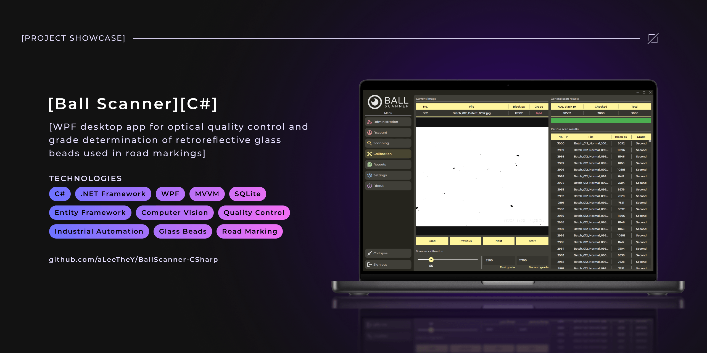
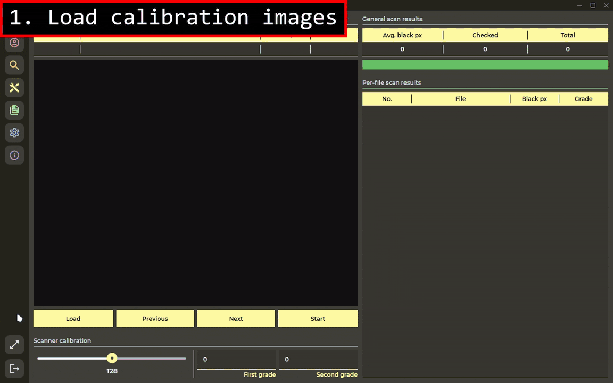
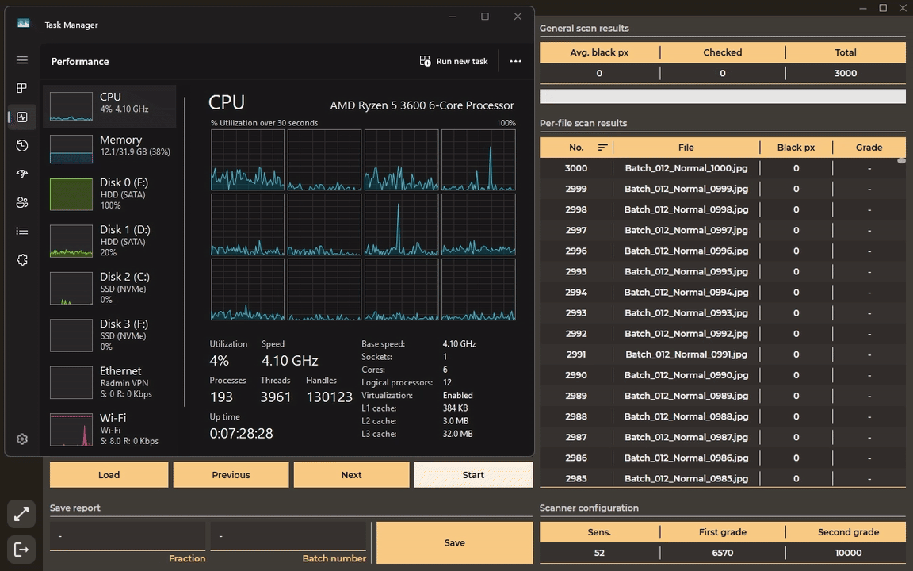
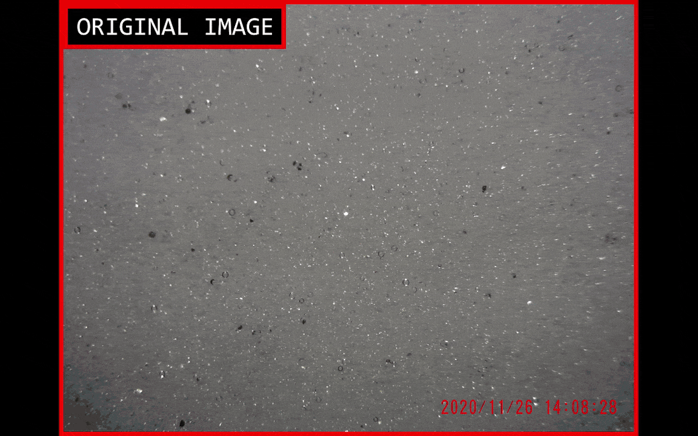
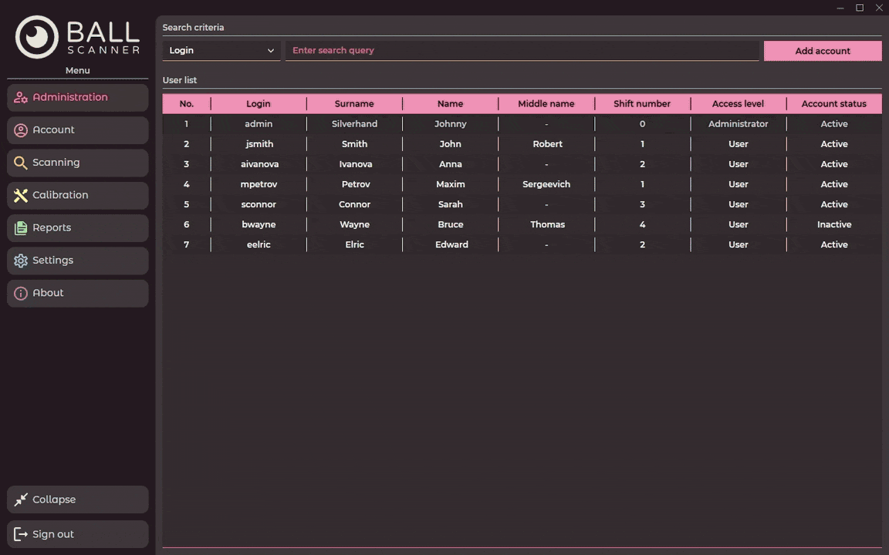
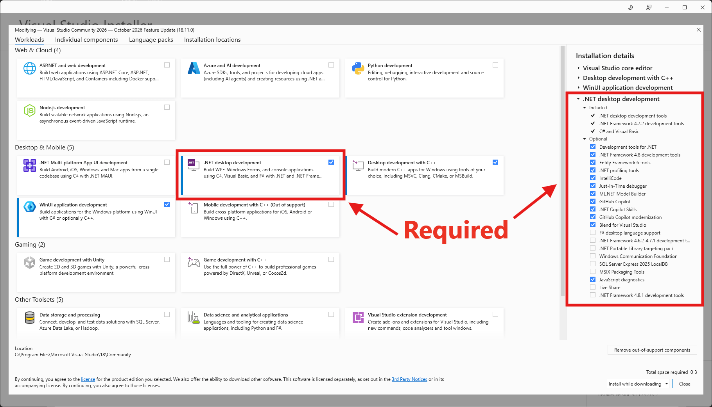
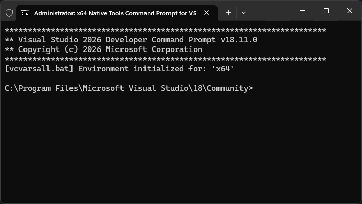

<!-- Improved compatibility of back to top link: See: https://github.com/othneildrew/Best-README-Template/pull/73 -->

<span id="readme-top"></span>

<!-- ! --- REPO SHIELDS --->
<!-- ! ---------------- --->

<div align="center">

[![Contributors][contributors-shield]][contributors-url]
[![Forks][forks-shield]][forks-url]
[![Stargazers][stars-shield]][stars-url]
[![Issues][issues-shield]][issues-url]
[![License][license-shield]][license-url]

![GitHub Last Commit][last-commit-shield]
![GitHub Repo Size][repo-size-shield]

[](README.md)
[](README.ru.md)

</div>

<!-- ! --- REPO HEADER --->
<!-- ! --------------- --->

<br />
<div align="center">
  <h1 align="center">Ball Scanner [C#]</h1>

  <p align="center">
    🔬 Настольное приложение WPF для оптического контроля качества и определения сортности световозвращающих стеклянных шариков, используемых в дорожной разметке.
    <br />
    <br />
    
    <hr />
    <b><a href="https://github.com/aLeeTheY/BallScanner-CSharp/releases/tag/1.1.0-beta">Скачать</a></b>
    &middot;
    <b><a href="https://github.com/aLeeTheY/BallScanner-CSharp/issues/new?labels=bug&template=bug-report.md">Сообщить об ошибке</a></b>
    <hr />
  </p>
</div>

<!-- ! --- TABLE OF CONTENTS --->
<!-- ! --------------------- --->

<details>
  <summary>📦 Содержание</summary>
  <ol>
    <li>
      <a href="#about-the-project">ℹ️ О проекте</a>
      <ul>
        <li>
          <a href="#showcase">🎬 Демонстрация работы</a>
          <ul>
            <li><a href="#workflow-showcase">🔄 Базовый сценарий использования</a></li>
            <li><a href="#multithreading-showcase">⚡ Многопоточная реализация</a></li>
            <li><a href="#binarization-showcase">🔬 Бинаризация изображений</a></li>
            <li><a href="#gui-showcase">🖥️ Обзор интерфейса</a></li>
          </ul>
        </li>
        <li><a href="#key-features">✨ Ключевые особенности</a></li>
        <li><a href="#built-with">🧰 Используемые технологии</a></li>
        <li><a href="#project-structure">📂 Структура проекта</a></li>
      </ul>
    </li>
    <li>
      <a href="#quick-start">🚀 Начало работы</a>
      <ul>
        <li><a href="#prerequisites">📋 Предварительные требования</a></li>
        <li><a href="#visual-studio-build">🅰️ Способ 1: Сборка через Visual Studio</a></li>
        <li><a href="#cli-build">🅱️ Способ 2: Сборка через командную строку</a></li>
        <li><a href="#nsis-build">💿 Сборка установщиков через NSIS (опционально)</a></li>
      </ul>
    </li>
    <li><a href="#usage">💡 Использование</a></li>
    <li><a href="#development-challenges">🧠 Сложности при разработке</a></li>
    <li><a href="#key-skills">📈 Полученные навыки</a></li>
    <li><a href="#roadmap">🗺️ Дорожная карта</a></li>
    <li><a href="#license">📄 Лицензия</a></li>
    <li><a href="#contact">🤝 Контакты</a></li>
    <li><a href="#acknowledgments">💖 Благодарности</a></li>
  </ol>
</details>

<!-- ! --- ABOUT THE PROJECT --->
<!-- ! --------------------- --->

## ℹ️ О проекте <span id="about-the-project"></span>

Цель проекта — создание настольного приложения для оптического контроля качества световозвращающих стеклянных шариков, используемых в дорожной разметке. Приложение разработано по заказу предприятия и позволяет сотруднику завода обрабатывать большое число снимков микросфер, определять сортность партии и сохранять результаты проверки в отчёты для дальнейшего просмотра.

<p align="right">(<a href="#readme-top">наверх</a>)</p>

<!-- ! --- DEMO / SHOWCASE --->
<!-- ! ------------------- --->

### 🎬 Демонстрация работы <span id="showcase"></span>

Ниже представлена видеодемонстрация ключевых возможностей программы:

<div align="center">

#### 🔄 Базовый сценарий использования <span id="workflow-showcase"></span>



<p align="right">(<a href="#readme-top">наверх</a>)</p>

#### ⚡ Многопоточная реализация <span id="multithreading-showcase"></span>



<p align="right">(<a href="#readme-top">наверх</a>)</p>

#### 🔬 Бинаризация изображений <span id="binarization-showcase"></span>



<p align="right">(<a href="#readme-top">наверх</a>)</p>

#### 🖥️ Обзор интерфейса <span id="gui-showcase"></span>



<p align="right">(<a href="#readme-top">наверх</a>)</p>

</div>

<!-- ! --- KEY FEATURES --->
<!-- ! ---------------- --->

### ✨ Ключевые особенности <span id="key-features"></span>

- 📊 **Точная оценка качества:** автоматический подсчёт дефектных (чёрных) пикселей на каждом загруженном снимке, присвоение ему сорта (Grade) и вычисление среднего значения по всей партии изображений.
- 🎚️ **Настраиваемый порог бинаризации:** оператор вручную задаёт `Threshold` (0–255), компенсируя различия в освещении и качестве снимков, — поэтому метод работает даже на неравномерно освещённых фото. Главное, чтобы условия съёмки были примерно одинаковыми внутри партии.
- ⚡ **Параллельная обработка:** многопоточный анализ изображений одновременно (каждое ядро CPU берёт отдельный снимок) без зависания интерфейса — до **3000 изображений разрешением 4320×3240 px за ~40 секунд** (~75 изобр./сек).
- 🗄️ **Управление данными:** сохранение результатов проверок в базе SQLite (с привязкой к номеру партии и фракции), а также удобный поиск и фильтрация по датам и другим полям.
- 🔐 **Разграничение прав:** защита данных от случайного изменения или удаления благодаря ролям Администратора и Сотрудника.
- 🎨 **Гибкий интерфейс:** авторский дизайн, тёмная/светлая тема, локализация (EN/RU) и адаптивная верстка под разные разрешения экранов.
- 💻 **Широкая совместимость:** поддержка Windows 7 и выше благодаря платформе .NET Framework 4.8.
- 🪶 **Легковесность:** установленная программа занимает всего около 20 МБ (без учёта данных в БД).
- 📦 **Удобная установка:** доступна портативная версия, а также классический инсталлятор для ПК.

> [!NOTE]
> **Тестовый стенд:**
>
> - **CPU:** AMD Ryzen 5 3600 (6 ядер / 12 потоков)
> - **RAM:** 32 ГБ
> - **OS:** Windows 11 25H2
> - **Данные:** 3000 изображений (4320×3240 px)
> - **Результат:** ~40 секунд (~75 изобр./сек)
>
> Скорость обработки **упирается в CPU**: бинаризация и подсчёт чёрных пикселей распараллелены по ядрам, поэтому производительность зависит от количества потоков и на другом железе будет отличаться.
>
> GPU-ускорение (CUDA/OpenCL), возможно, будет реализовано в будущем — см. [Дорожную карту](#roadmap).

<p align="right">(<a href="#readme-top">наверх</a>)</p>

<!-- ! --- BUILT WITH --->
<!-- ! -------------- --->

### 🧰 Используемые технологии <span id="built-with"></span>

_Для удобства вся информация разбита по категориям._

<details>
<summary>🧩 Архитектура и паттерны</summary>

- [![MVVM][MVVM-logo]][MVVM-url] <sup>— архитектурный шаблон для разделения интерфейса и логики (Model-View-ViewModel)</sup>
- [![MVVM Command Pattern][MVVMCommandPattern-logo]][MVVMCommandPattern-url] <sup>— поведенческий паттерн для инкапсуляции действий приложения в команды</sup>

</details>

<details>
<summary>🎨 Frontend (пользовательский интерфейс)</summary>

- [![WPF][WPF-logo]][WPF-url] <sup>— технология создания десктопного интерфейса (Windows Presentation Foundation)</sup>
- [![XAML][XAML-logo]][XAML-url] <sup>— декларативный язык разметки интерфейса и стилей</sup>

</details>

<details>
<summary>⚙️ Backend (бизнес-логика)</summary>

- [![C#][C#-logo]][C#-url] <sup>— основной язык разработки приложения</sup>
- [![.NET Framework 4.8][DNF48-logo]][DNF48-url] <sup>— платформа выполнения приложения</sup>
- [![Entity Framework][EntityFramework-logo]][EntityFramework-url] <sup>— ORM для работы с базой данных через объекты C#</sup>
- [![NLog][NLog-logo]][NLog-url] <sup>— библиотека для логирования событий приложения</sup>

</details>

<details>
<summary>💾 База данных</summary>

- [![SQLite][SQLite-logo]][SQLite-url] <sup>— легковесная встраиваемая реляционная база данных</sup>

</details>

<details>
<summary>📦 Сборка и создание установщика</summary>

- [![NSIS][NSIS-logo]][NSIS-url] <sup>— система создания установщиков для Windows (Nullsoft Scriptable Install System)</sup>

</details>

<details>
<summary>📝 Стиль кода и форматирование</summary>

- [![EditorConfig][EditorConfig-logo]][EditorConfig-url] <sup>— единые соглашения о форматировании и стиле кода</sup>

</details>

<details>
<summary>🌿 Контроль версий и хостинг репозитория</summary>

- [![Git][Git-logo]][Git-url] <sup>— распределённая система контроля версий</sup>
- [![GitHub][GitHub-logo]][GitHub-url] <sup>— платформа для хранения исходного кода и публикации релизов</sup>

</details>

<details>
<summary>🖥️ Инструменты разработки</summary>

- [![Figma][Figma-logo]][Figma-url] <sup>— инструмент проектирования UI/UX-макетов</sup>
- [![Visual Studio][VisualStudio-logo]][VisualStudio-url] <sup>— основная IDE для разработки C# и WPF-приложения</sup>
- [![Visual Studio Code][VSCode-logo]][VSCode-url] <sup>— вспомогательный редактор кода</sup>
- [![SQLite DB Browser][SQLiteDBBrowser-logo]][SQLiteDBBrowser-url] <sup>— инструмент просмотра и редактирования баз данных SQLite</sup>

</details>

<p align="right">(<a href="#readme-top">наверх</a>)</p>

<!-- ! --- PROJECT STRUCTURE --->
<!-- ! --------------------- --->

### 📂 Структура проекта <span id="project-structure"></span>

Основные каталоги и файлы проекта:

```text
BallScanner-CSharp
│
├── .vscode/
│   └── settings.json                                   # настройки рабочей области для VS Code
│
├── aLeeTheY.Controls/                                  # библиотека с кастомными компонентами интерфейса
│   ├── Properties/                                     # стандартные файлы проекта (сборка, ресурсы, настройки)
│   │   ├── AssemblyInfo.cs
│   │   ├── Resources.Designer.cs
│   │   ├── Resources.resx
│   │   ├── Settings.Designer.cs
│   │   └── Settings.settings
│   │
│   ├── Styles/                                         # стили для стандартных компонентов WPF
│   │   ├── Button_Style.xaml
│   │   ├── ComboBox_Style.xaml
│   │   ├── GridSplitter_Style.xaml
│   │   ├── LabelTextBox_Inside_Style.xaml
│   │   ├── LabelTextBox_Multiline_Style.xaml
│   │   ├── PasswordBox_Style.xaml
│   │   ├── ProgressBar_Style.xaml
│   │   ├── ScrollBar_Style.xaml
│   │   ├── ScrollViewer_Style.xaml
│   │   ├── Slider_Style.xaml
│   │   ├── Styles.xaml
│   │   ├── TextBlock_Style.xaml
│   │   └── TextBox_Style.xaml
│   │
│   ├── Themes/                                         # стили для кастомных компонентов интерфейса
│   │   ├── BlockHeader_Style.xaml
│   │   ├── Generic.xaml
│   │   ├── JustButton_Style.xaml
│   │   ├── LabelComboBox_Style.xaml
│   │   ├── LabelTextBox_Style.xaml
│   │   ├── MenuButton_Style.xaml
│   │   └── SimpleRadioButton_Style.xaml
│   │
│   ├── aLeeTheY.Controls.csproj
│   ├── aLeeTheY__KeyFile.pfx                           # файл цифрового сертификата для подписи (неофициальный)
│   ├── BlockHeader.cs
│   ├── JustButton.cs
│   ├── LabelComboBox.cs
│   ├── LabelPasswordBox.cs
│   ├── LabelTextBox.cs
│   ├── MenuButton.cs
│   └── SimpleRadioButton.cs
│
├── aLeeTheY.Resources/                                 # библиотека сторонних ресурсов
│   ├── Fonts/
│   │   ├── Montserrat/
│   │   └── Montserrat_Alternates/
│   │
│   ├── Properties/                                     # стандартные файлы проекта (сборка, ресурсы, настройки)
│   │   ├── AssemblyInfo.cs
│   │   ├── Resources.Designer.cs
│   │   ├── Resources.resx
│   │   ├── Settings.Designer.cs
│   │   └── Settings.settings
│   │
│   └── aLeeTheY.Resources.csproj
│
├── aLeeTheY.Utils/                                     # библиотека утилит и вспомогательных классов
│   ├── Behaviors/                                      # присоединяемые поведения для элементов интерфейса
│   │   └── ScaleFontBehavior.cs
│   │
│   ├── Converters/                                     # преобразователи значений (конвертеры)
│   │   ├── BlockingConverter.cs
│   │   ├── LogicalConverter.cs
│   │   ├── NotePreviewConverter.cs
│   │   └── RowToIndexConverter.cs
│   │
│   ├── Helpers/                                        # вспомогательные классы
│   │   ├── Converters.cs
│   │   └── VisualHelper.cs
│   │
│   ├── Observers/                                      # наблюдатели (отслеживание изменений размеров и т.п.)
│   │   └── SizeObserver.cs
│   │
│   ├── Other/                                          # прочие вспомогательные классы
│   │   ├── SetMinWidthToAutoAttachedBehavior.cs
│   │   └── ViewBoxConstantFontSizeConverter.cs
│   │
│   ├── Properties/                                     # стандартные файлы проекта
│   │   └── AssemblyInfo.cs
│   │
│   ├── Services/                                       # сервисы (авторизация, хеширование, работа с окнами)
│   │   ├── IAuthenticationService.cs
│   │   ├── SHAService.cs
│   │   └── WindowService.cs
│   │
│   ├── aLeeTheY.Utils.csproj
│   ├── aLeeTheY__KeyFile.pfx                           # файл цифрового сертификата для подписи (неофициальный)
│   └── packages.config                                 # список NuGet-пакетов
│
├── BallScanner/                                        # основной проект (приложение)
│   ├── Data/
│   │   ├── Tables/                                     # сущности (таблицы) базы данных, доступны из любой части приложения
│   │   │   ├── Report.cs
│   │   │   └── User.cs
│   │   │
│   │   ├── AppDbContext.cs                             # контекст подключения к базе данных (Entity Framework)
│   │   └── db.sqlite3                                  # файл базы данных SQLite (заготовка/шаблон)
│   │
│   ├── MVVM/                                           # архитектура MVVM (разделение данных, логики и интерфейса)
│   │   ├── Base/                                       # базовые классы для моделей представления
│   │   │   ├── BaseViewModel.cs
│   │   │   └── PageVM.cs
│   │   │
│   │   ├── Commands/                                   # команды (реализация паттерна Command)
│   │   │   └── RelayCommand.cs
│   │   │
│   │   ├── Models/                                     # модели данных уровня страниц (не таблицы БД)
│   │   │   └── Main/
│   │   │       ├── BallGrade.cs
│   │   │       └── ImageData.cs
│   │   │
│   │   ├── ViewModels/                                 # логика приложения для окон и страниц
│   │   │   ├── Add/                                    # окно регистрации пользователя
│   │   │   │   ├── RegistrationVM.cs
│   │   │   │   └── RootVM.cs
│   │   │   │
│   │   │   ├── Auth/                                   # окно авторизации
│   │   │   │   ├── LoginVM.cs
│   │   │   │   └── RootVM.cs
│   │   │   │
│   │   │   ├── Edit/                                   # окна редактирования данных
│   │   │   │   ├── EditReportsVM.cs
│   │   │   │   ├── EditUsersVM.cs
│   │   │   │   └── RootVM.cs
│   │   │   │
│   │   │   └── Main/                                   # основное окно приложения и его страницы
│   │   │       ├── AboutVM.cs
│   │   │       ├── AccountManagementVM.cs
│   │   │       ├── AccountVM.cs
│   │   │       ├── CalibrateVM.cs
│   │   │       ├── DocumentsVM.cs
│   │   │       ├── MenuVM.cs
│   │   │       ├── RootVM.cs
│   │   │       ├── ScanVM.cs
│   │   │       └── SettingsVM.cs
│   │   │
│   │   └── Views/                                      # интерфейс (разметка) окон и страниц
│   │       ├── Add/                                    # окно регистрации пользователя
│   │       │   ├── RegistrationV.xaml
│   │       │   ├── RegistrationV.xaml.cs
│   │       │   ├── RootV.xaml
│   │       │   └── RootV.xaml.cs
│   │       │
│   │       ├── Auth/                                   # окно авторизации
│   │       │   ├── LoginV.xaml
│   │       │   ├── LoginV.xaml.cs
│   │       │   ├── RootV.xaml
│   │       │   └── RootV.xaml.cs
│   │       │
│   │       ├── Edit/                                   # окна редактирования данных
│   │       │   ├── EditReportsV.xaml
│   │       │   ├── EditReportsV.xaml.cs
│   │       │   ├── EditUsersV.xaml
│   │       │   ├── EditUsersV.xaml.cs
│   │       │   ├── RootV.xaml
│   │       │   └── RootV.xaml.cs
│   │       │
│   │       └── Main/                                   # основное окно приложения и его страницы
│   │           ├── AboutV.xaml
│   │           ├── AboutV.xaml.cs
│   │           ├── AccountManagementV.xaml
│   │           ├── AccountManagementV.xaml.cs
│   │           ├── AccountV.xaml
│   │           ├── AccountV.xaml.cs
│   │           ├── CalibrateV.xaml
│   │           ├── CalibrateV.xaml.cs
│   │           ├── DocumentsV.xaml
│   │           ├── DocumentsV.xaml.cs
│   │           ├── MenuV.xaml
│   │           ├── MenuV.xaml.cs
│   │           ├── RootV.xaml
│   │           ├── RootV.xaml.cs
│   │           ├── ScanV.xaml
│   │           ├── ScanV.xaml.cs
│   │           ├── SettingsV.xaml
│   │           └── SettingsV.xaml.cs
│   │
│   ├── Properties/                                     # стандартные файлы проекта (сборка, ресурсы, настройки)
│   │   ├── AssemblyInfo.cs
│   │   ├── Resources.Designer.cs
│   │   ├── Resources.resx
│   │   ├── Settings.Designer.cs
│   │   └── Settings.settings
│   │
│   ├── Resources/                                      # локальные ресурсы проекта
│   │   ├── Fonts/                                      # шрифты
│   │   │   ├── Montserrat/
│   │   │   ├── Montserrat_Alternates/
│   │   │   └── Fonts.xaml
│   │   │
│   │   ├── Icons/                                      # векторные иконки (геометрия XAML)
│   │   │   └── Icons.xaml
│   │   │
│   │   ├── Languages/                                  # файлы переводов (локализация)
│   │   │   ├── Language.en-US.xaml
│   │   │   └── Language.ru-RU.xaml
│   │   │
│   │   ├── Palettes/                                   # палитры (цветовые схемы) для страниц
│   │   │   ├── Dark                                    # темная тема
│   │   │   │   ├── Blue.xaml
│   │   │   │   ├── Green.xaml
│   │   │   │   ├── Orange.xaml
│   │   │   │   ├── Pink.xaml
│   │   │   │   ├── Purple.xaml
│   │   │   │   ├── Red.xaml
│   │   │   │   └── Yellow.xaml
│   │   │   │
│   │   │   ├── Light                                   # светлая тема
│   │   │   │   ├── Blue.xaml
│   │   │   │   ├── Green.xaml
│   │   │   │   ├── Orange.xaml
│   │   │   │   ├── Pink.xaml
│   │   │   │   ├── Purple.xaml
│   │   │   │   ├── Red.xaml
│   │   │   │   └── Yellow.xaml
│   │   │   │
│   │   │   └── Old                                     # старый вариант (не используется)
│   │   │       ├── Blue/
│   │   │       │   ├── Dark.xaml
│   │   │       │   └── Light.xaml
│   │   │       │
│   │   │       ├── Green/
│   │   │       │   ├── Dark.xaml
│   │   │       │   └── Light.xaml
│   │   │       │
│   │   │       ├── Orange/
│   │   │       │   ├── Dark.xaml
│   │   │       │   └── Light.xaml
│   │   │       │
│   │   │       ├── Purple/
│   │   │       │   ├── Dark.xaml
│   │   │       │   └── Light.xaml
│   │   │       │
│   │   │       ├── Red/
│   │   │       │   ├── Dark.xaml
│   │   │       │   └── Light.xaml
│   │   │       │
│   │   │       ├── Yellow/
│   │   │       │   ├── Dark.xaml
│   │   │       │   └── Light.xaml
│   │   │       │
│   │   │       ├── Dark.xaml
│   │   │       └── Light.xaml
│   │   │
│   │   ├── Styles/                                     # стили локальных компонентов, не относящихся к страницам MVVM
│   │   │   ├── CustomWindowStyle.cs
│   │   │   ├── CustomWindowStyle.xaml                  # стилизация окон
│   │   │   ├── DataGrid_Style.cs
│   │   │   ├── DataGrid_Style.xaml                     # стилизация таблиц
│   │   │   └── WindowChromeButtons.xaml                # кнопки управления окном (свернуть, развернуть, закрыть)
│   │   │
│   │   └── Values/                                     # глобальные константы и значения (цвета, размеры, строки)
│   │       └── Values.xaml
│   │
│   ├── aLeeTheY__KeyFile.pfx                           # файл цифрового сертификата для подписи (неофициальный)
│   ├── App.config                                      # конфигурация .NET-приложения
│   ├── app.manifest                                    # манифест приложения (права, DPI, версия Windows)
│   ├── App.xaml                                        # точка входа приложения
│   ├── App.xaml.cs
│   ├── BallScanner.csproj
│   ├── favicon.ico                                     # иконка приложения
│   ├── NLog.config                                     # настройка логирования (NLog)
│   ├── NLog.xsd
│   └── packages.config                                 # список NuGet-пакетов
│
├── docs/                                               # документация и ресурсы для README
│   └── assets/
│       ├── ffmpeg/                                     # команды конвертации .mp4 --> .gif
│       │   └── commands.txt
│       │
│       ├── 00__repo_cover.png                          # обложка репозитория
│       ├── 01__usage_workflow.gif
│       ├── 02__multithread.gif
│       ├── 03__binarization.gif
│       ├── 04__gui.gif
│       ├── quick_start__1.png
│       └── quick_start__2.png
│
├── installer/                                          # исходные файлы для сборки установщика (NSIS)
│   ├── external/                                       # сторонние установщики, используемые в скриптах NSIS
│   │   ├── ndp48-web.exe                               # веб-установщик .NET Framework 4.8
│   │   └── signtool.exe                                # утилита для подписи файлов (используется в sign.bat)
│   │
│   ├── output/                                         # папка для готовых установщиков
│   │   └── .gitkeep
│   │
│   ├── BallScanner_windows_x64_setup.nsi               # скрипт сборки установщика для 64-битной версии
│   ├── BallScanner_windows_x86_setup.nsi               # скрипт сборки установщика для 32-битной версии
│   └── sign.bat                                        # скрипт подписи установщиков цифровым сертификатом
│
├── samples/                                            # тестовые изображения для проверки работы
│   ├── defect/                                         # бракованные стеклошарики
│   ├── good/                                           # стеклошарики 1-го сорта
│   └── normal/                                         # стеклошарики 2-го сорта
│
├── .editorconfig                                       # настройки форматирования кода
├── .gitattributes
├── .gitignore
├── BallScanner-CSharp.sln                              # файл решения Visual Studio (объединяет все проекты)
├── LICENSE                                             # файл лицензии PolyForm Noncommercial License 1.0.0
├── README.md
└── README.ru.md
```

<p align="right">(<a href="#readme-top">наверх</a>)</p>

<!-- ! --- QUICK START --->
<!-- ! --------------- --->

## 🚀 Начало работы <span id="quick-start"></span>

_Следуйте приведённым ниже инструкциям для сборки и запуска программы на своём ПК._

### 📋 Предварительные требования <a id="prerequisites"></a>

1. Для сборки и запуска проекта вам понадобится **Visual Studio Community 2026**. Скачать её можно с [официального сайта Microsoft][VisualStudioInstaller-url].<br />
   Во время установки во вкладке **«Рабочие нагрузки» (Workloads)** обязательно выберите пункт: **`.NET desktop development`** (разработка классических приложений .NET).

> [!TIP]
> Пример правильной установки **`.NET desktop development`** workload в Visual Studio Installer:
>
> 

2. Скачайте данный репозиторий в виде ZIP-архива или клонируйте его с помощью [Git][Git-url] и перейдите в каталог проекта:

```powershell
git clone https://github.com/aLeeTheY/BallScanner-CSharp
cd BallScanner-CSharp/
```

Далее процесс сборки можно выполнить двумя способами. Выбирайте подходящий для себя.

---

> [!WARNING]
> Способы ниже описывают сборку Portable-версии приложения. В зависимости от выбранной платформы сборки, файлы будут располагаться в одной из следующих директорий:
>
> ```powershell
> # обычный билд (без указания /p:Platform)
> BallScanner/bin/Release/
>
> # билд под x64 системы (флаг /p:Platform=x64)
> BallScanner/bin/x64/Release/
>
> # билд под x86 системы (флаг /p:Platform=x86)
> BallScanner/bin/x86/Release/
> ```

---

### 🅰️ Способ 1: Сборка через Visual Studio <a id="visual-studio-build"></a>

_Это самый простой способ, не требующий знания командной строки._

1. Запустите Visual Studio.
2. В окне программы откройте файл решения **`BallScanner-CSharp.sln`**.
3. После инициализации проекта, в верхнем меню выберите **Сборка -> Собрать решение** (или нажмите `Ctrl+Shift+B`).
4. По завершению сборки, нажмите на кнопку **Пуск** на верхней панели инструментов (или клавишу `F5`).
5. Приложение запущено.

---

### 🅱️ Способ 2: Сборка через командную строку <a id="cli-build"></a>

_Для тех, кто предпочитает работать через терминал._

1. В дополнение к уже установленной Visual Studio, вам нужно [**скачать NuGet CLI**][NuGetCLI]. После скачивания, добавьте `nuget.exe` в переменные окружения `PATH` вашей ОС или положите данный файл в текущую директорию, рядом с решением **`BallScanner-CSharp.sln`**.
2. Visual Studio предоставляет командную строку с настроенным окружением: `x64 Native Tools Command Prompt for VS`. Запустите её.

> [!TIP]
> Демонстрация запущенного терминала с окружением для разработки `x64 Native Tools Command Prompt for VS`:
>
> 

3. В открывшемся терминале, выполните три команды для сборки и запуска проекта:

```powershell
# 1. Установить NuGet-зависимости (Entity Framework, NLog, SQLite)
nuget restore BallScanner-CSharp.sln

# 2. Собрать решение в конфигурации Release для 64-битных систем
#    (для сборки 32-битной версии используйте флаг /p:Platform=x86)
msbuild BallScanner-CSharp.sln /p:Configuration=Release /p:Platform=x64 /m

# 3. Запуск готового приложения (кавычки обязательны из-за пробела)
.\BallScanner\bin\x64\Release\"Ball Scanner.exe"
```

4. Приложение запущено.

---

### 💿 Сборка установщиков через NSIS (опционально) <a id="nsis-build"></a>

_Используя варианты сборки, которые были описаны выше, вы можете получить Portable-версии программы для систем x86 и x64. Данная инструкция описывает способ создания установщика из этих Portable-версий._

1. Скачайте и установите компилятор [**Nullsoft Scriptable Install System (NSIS)**][NSISInstaller].
2. Откройте терминал и убедитесь, что команда `makensis.exe` доступна; в противном случае, добавьте её в переменные окружения `PATH` вашей ОС.
3. Также, убедитесь что вы собрали Portable-версию с конкретной битностью системы (`x86` или `x64`).
4. Перейдите из корня проекта в директорию `installer/` и выполните список команд ниже для получения готовых установщиков:

```powershell
# переход в директорию BallScanner/installer/
cd installer/

# сборка установщика для версии x64
makensis.exe BallScanner_windows_x64_setup.nsi

# сборка установщика для версии x86
makensis.exe BallScanner_windows_x86_setup.nsi

# цифровая подпись установщиков
.\sign.bat
```

Собранные установщики располагаются в папке `BallScanner/installer/output/`.

<p align="right">(<a href="#readme-top">наверх</a>)</p>

<!-- ! --- USAGE --->
<!-- ! --------- --->

## 💡 Использование <span id="usage"></span>

После запуска приложения перед вами откроется окно авторизации. Для входа в демонстрационную версию используйте следующие учётные данные:

```text
Логин:  admin
Пароль: admin
```

После авторизации вам станет доступен основной интерфейс программы. С визуальной демонстрацией работы приложения можно ознакомиться в разделе [**Демонстрация работы**](#showcase).

> [!TIP]
> Для быстрой проверки работы приложения рекомендуется использовать фотографии микросфер из директории `samples/`. Они разбиты по качеству: `good` — 1-й сорт, `normal` — 2-й сорт, `defect` — брак.

> [!IMPORTANT]
> **Перед первым сканированием необходимо откалибровать сканер и задать пороги сортности:**
>
> 1. На странице **Калибровка** настройте ползунок `Threshold` (0–255) под текущее освещение.
> 2. Загрузите партию изображений **1-го сорта**. Программа рассчитает количество чёрных пикселей для каждого снимка.
> 3. Найдите максимальное значение по партии и **вручную впишите** его в поле **Первый сорт**.
> 4. Повторите шаги 2–3 для образцов **2-го сорта** и заполните поле **Второй сорт**.
>
> _После этого программа будет автоматически присваивать сорт (Grade) при проверке любых других партий на основе заданных настроек сканера._

<p align="right">(<a href="#readme-top">наверх</a>)</p>

<!-- ! --- DEVELOPMENT CHALLENGES --->
<!-- ! -------------------------- --->

## 🧠 Сложности при разработке <span id="development-challenges"></span>

- **Создание авторской дизайн-системы:** в WPF нет многих готовых компонентов, соответствующих дизайну, поэтому для некоторых из них пришлось вручную реализовывать `ControlTemplate`'ы, чтобы весь визуал работал в синергии.
- **Освоение MVVM:** переход от событийной модели (`code-behind`) к связыванию данных (`Data Binding`) и триггерам потребовал времени на переосмысление архитектуры.
- **Кастомизация окон (`WindowChrome`):** удаление стандартной рамки Windows ломает встроенное поведение окна (перетаскивание, изменение размера), из-за чего пришлось реализовывать эту логику вручную в угоду дизайну.
- **Многопоточность:** при обработке изображений интерфейс полностью зависал. Задачу решило распараллеливание: процесс подсчёта чёрных пикселей вынесен в отдельный поток, где каждое ядро CPU обрабатывает отдельное изображение, а UI-поток остаётся свободным.
- **Обработка изображений:** изучение методов создания бинарных изображений через `Threshold` потребовало чтения документации и применения метода проб и ошибок.
- **Запросы к БД:** работа через Entity Framework и LINQ потребовала понимания того, как правильно строить запросы к объектам классов без прямого использования SQL.
- **Отказоустойчивость:** пользователь может допускать ошибки при работе с программой. Потребовалось внедрить механизмы валидации данных и защиты от крашей (методами `try/catch`) во все критически важные узлы программы.

<p align="right">(<a href="#readme-top">наверх</a>)</p>

<!-- ! --- KEY SKILLS --->
<!-- ! -------------- --->

## 📈 Полученные навыки <span id="key-skills"></span>

- **Разработка в экосистеме WPF:** C#, XAML, .NET Framework 4.8 и NuGet.
- **Архитектура:** проектирование приложений по паттерну **MVVM** (через реализацию `Command` и `Data Binding`).
- **UI/UX и дизайн:** проектирование интерфейсов в **Figma** и их реализация средствами WPF.
- **Работа с данными:** проектирование структуры БД, работа с **SQLite**, утилитой **SQLite DB Browser**, **Entity Framework** и запросами **LINQ**.
- **Разграничение прав доступа:** реализация ролевой модели (администратор/сотрудник) с ограничением видимости некоторых окон/страниц, а также ограничением на модификацию/удаление данных в БД.
- **Создание установщиков:** написание скриптов на **NSIS** для компиляции установочных файлов (инсталляторов) под Windows.

<p align="right">(<a href="#readme-top">наверх</a>)</p>

<!-- ! --- ROADMAP --->
<!-- ! ----------- --->

## 🗺️ Дорожная карта <span id="roadmap"></span>

- [x] Проектирование UI/UX дизайна окон и страниц приложения в Figma
- [x] Проектирование структуры базы данных и создание её шаблона на базе SQLite
- [x] Реализация архитектурного паттерна **MVVM** (Model, View, ViewModel) и настройка подключения к БД
- [x] Верстка интерфейса на XAML: реализация кастомных UI-компонентов и их компоновка в единый GUI
- [x] Разработка базового алгоритма подсчёта чёрных точек (однопоточный цикл)
- [x] Оптимизация алгоритма: внедрение многопоточности (параллельная обработка каждого изображения на отдельном ядре CPU)
- [x] Внедрение ролевой системы работы с приложением (администратор/сотрудник) + регистрация/авторизация
- [x] Внедрение механизмов обработки исключений (`try/catch`) для защиты от сбоев при работе с файлами и БД
- [x] Добавление полной поддержки английского языка (интернационализация)
- [ ] Исправление отображения иконки сортировки (ORDER BY) в заголовках DataGrid при малых размерах экрана
- [ ] Добавление автоматической калибровки порогов сортности (**Первый сорт** / **Второй сорт**) на основе эталонной партии вместо ручного ввода
- [ ] Добавление возможности сохранения параметров калибровки (Sensitivity и Grades) в отчёте для обеспечения прослеживаемости результатов
- [ ] Добавление встроенной функции печати отчётов напрямую из приложения
- [ ] Добавление функции экспорта отчётов в формат **PDF**
- [ ] Внедрение аппаратного ускорения (**GPU**) для обработки изображений (CUDA / OpenCL)
- [ ] Портирование приложения под другие ОС (**Linux**, **macOS**)

Полный список планируемых функций и известных проблем доступен в разделе [Issues][issues-url].

<p align="right">(<a href="#readme-top">наверх</a>)</p>

<!-- ! --- LICENSE --->
<!-- ! ----------- --->

## 📄 Лицензия <span id="license"></span>

Copyright © 2021–2026 [aLeeTheY](https://github.com/aLeeTheY)

Проект распространяется по лицензии [**PolyForm Noncommercial License 1.0.0**](https://polyformproject.org/licenses/noncommercial/1.0.0) и открыт для личного использования, обучения, исследований и некоммерческих целей. Коммерческое использование, перепродажа или использование в коммерческих продуктах запрещены.

Смотрите файл [`LICENSE`][license-url] для получения подробной информации.

<p align="right">(<a href="#readme-top">наверх</a>)</p>

<!-- ! --- CONTACT --->
<!-- ! ----------- --->

## 🤝 Контакты <span id="contact"></span>

<!-- [![GitHub][GitHub-logo]](https://github.com/aLeeTheY)
[![Telegram][Telegram-logo]](https://t.me/aLeeTheY)
[![Gmail][Gmail-logo]](mailto:aleethey@gmail.com) -->

GitHub: [aLeeTheY](https://github.com/aLeeTheY)
<br/>
Telegram: [@aLeeTheY](https://t.me/aLeeTheY)
<br/>
Email: [aleethey@gmail.com](mailto:aleethey@gmail.com)

<p align="right">(<a href="#readme-top">наверх</a>)</p>

<!-- ! --- ACKNOWLEDGMENTS --->
<!-- ! ------------------- --->

## 💖 Благодарности <span id="acknowledgments"></span>

[aLeeTheY](https://github.com/aLeeTheY) выражает благодарность разработчикам и сообществам следующих проектов:

- [C#](https://dotnet.microsoft.com/en-us/languages/csharp)
- [.NET Framework](https://learn.microsoft.com/en-us/dotnet/framework/)
- [WPF](https://learn.microsoft.com/en-us/dotnet/desktop/wpf/)
- [Entity Framework](https://learn.microsoft.com/en-us/ef/)
- [SQLite](https://www.sqlite.org/)
- [NLog](https://nlog-project.org/)
- [NuGet](https://www.nuget.org/)
- [NSIS](https://nsis.sourceforge.io/)
- [Visual Studio](https://visualstudio.microsoft.com/)
- [Visual Studio Code](https://code.visualstudio.com/)
- [SQLite DB Browser](https://sqlitebrowser.org/)
- [Figma](https://www.figma.com/)
- [Git](https://git-scm.com/)
- [GitHub](https://github.com/)
- [Shields.io](https://shields.io/) (за красивые бейджи)
- [Custom Icon Badges](https://github.com/DenverCoder1/custom-icon-badges)
- [FFmpeg](https://ffmpeg.org/)
- [ezgif.com](https://ezgif.com/)
- [PolyForm Project](https://polyformproject.org/)

Без этих инструментов разработка данного проекта была бы **невозможна**.

<p align="right">(<a href="#readme-top">наверх</a>)</p>

<!-- ! --- MARKDOWN LINKS --->
<!-- ! ------------------ --->

<!-- * shields --->

[contributors-shield]: https://img.shields.io/github/contributors/aLeeTheY/BallScanner-CSharp.svg?style=for-the-badge
[contributors-url]: https://github.com/aLeeTheY/BallScanner-CSharp/graphs/contributors
[forks-shield]: https://img.shields.io/github/forks/aLeeTheY/BallScanner-CSharp.svg?style=for-the-badge
[forks-url]: https://github.com/aLeeTheY/BallScanner-CSharp/network/members
[stars-shield]: https://img.shields.io/github/stars/aLeeTheY/BallScanner-CSharp.svg?style=for-the-badge
[stars-url]: https://github.com/aLeeTheY/BallScanner-CSharp/stargazers
[issues-shield]: https://img.shields.io/github/issues/aLeeTheY/BallScanner-CSharp.svg?style=for-the-badge
[issues-url]: https://github.com/aLeeTheY/BallScanner-CSharp/issues
[last-commit-shield]: https://img.shields.io/github/last-commit/aLeeTheY/BallScanner-CSharp?style=for-the-badge
[repo-size-shield]: https://img.shields.io/github/repo-size/aLeeTheY/BallScanner-CSharp?style=for-the-badge
[license-shield]: https://img.shields.io/badge/License-PolyForm_Noncommercial-critical?style=for-the-badge
[license-url]: https://github.com/aLeeTheY/BallScanner-CSharp/blob/master/LICENSE

<!-- * technologies --->

[C#-logo]: https://img.shields.io/badge/C%23-512bd4?style=for-the-badge&logo=c-sharp&logoColor=white
[C#-url]: https://learn.microsoft.com/en-us/dotnet/csharp/
[WPF-logo]: https://img.shields.io/badge/Windows%20Presentation%20Foundation-1f1f1f?style=for-the-badge&logoColor=white
[WPF-url]: https://learn.microsoft.com/en-us/dotnet/desktop/wpf/
[DNF48-logo]: https://img.shields.io/badge/.NET_Framework_4.8-512bd4?style=for-the-badge&logo=.net&logoColor=white
[DNF48-url]: https://learn.microsoft.com/en-us/dotnet/framework/
[EntityFramework-logo]: https://img.shields.io/badge/Entity_Framework-512bd4?style=for-the-badge&logo=.net&logoColor=white
[EntityFramework-url]: https://learn.microsoft.com/en-us/ef/
[NLog-logo]: https://custom-icon-badges.demolab.com/badge/NLog-fff?logo=nlog&style=for-the-badge&logoColor=black
[NLog-url]: https://nlog-project.org/documentation/
[SQLite-logo]: https://img.shields.io/badge/sqlite-07405e?style=for-the-badge&logo=sqlite&logoColor=white
[SQLite-url]: https://www.sqlite.org/docs.html
[NSIS-logo]: https://custom-icon-badges.demolab.com/badge/NSIS-064b4e?logo=nsis&style=for-the-badge&logoColor=white
[NSIS-url]: https://nsis.sourceforge.io/
[XAML-logo]: https://custom-icon-badges.demolab.com/badge/XAML-05aceb?logo=xaml&style=for-the-badge&logoColor=white
[XAML-url]: https://learn.microsoft.com/en-us/dotnet/desktop/wpf/xaml/

<!-- * architecture & patterns --->

[MVVM-logo]: https://custom-icon-badges.demolab.com/badge/MVVM-1f1f1f?&style=for-the-badge&logoColor=white
[MVVM-url]: https://learn.microsoft.com/en-us/dotnet/architecture/maui/mvvm
[MVVMCommandPattern-logo]: https://custom-icon-badges.demolab.com/badge/MVVM%20Command%20Pattern-1f1f1f?&style=for-the-badge&logoColor=white
[MVVMCommandPattern-url]: https://learn.microsoft.com/en-us/archive/msdn-magazine/2013/may/mvvm-commands-relaycommands-and-eventtocommand

<!-- * linters & code format --->

[EditorConfig-logo]: https://custom-icon-badges.demolab.com/badge/EditorConfig-010101?logo=editorconfig&style=for-the-badge
[EditorConfig-url]: https://editorconfig.org/

<!-- * ide & workspace --->

[VSCode-logo]: https://custom-icon-badges.demolab.com/badge/Visual%20Studio%20Code-0d1014?logo=vscode&logoColor=white&style=for-the-badge
[VSCode-url]: https://code.visualstudio.com/
[Figma-logo]: https://img.shields.io/badge/figma-%23F24E1E.svg?style=for-the-badge&logo=figma&logoColor=white
[Figma-url]: https://www.figma.com/
[VisualStudio-logo]: https://custom-icon-badges.demolab.com/badge/Visual%20Studio-212121?logo=visual-studio-2026&style=for-the-badge&logoColor=white
[VisualStudio-url]: https://visualstudio.microsoft.com/
[SQLiteDBBrowser-logo]: https://custom-icon-badges.demolab.com/badge/SQLite%20DB%20Browser-f5f5f5?logo=sqlite-db-browser&style=for-the-badge&logoColor=black
[SQLiteDBBrowser-url]: https://sqlitebrowser.org/

<!-- * version control --->

[Git-logo]: https://img.shields.io/badge/git-F05033?style=for-the-badge&logo=git&logoColor=white
[Git-url]: https://git-scm.com/
[GitHub-logo]: https://img.shields.io/badge/github-121011?style=for-the-badge&logo=github&logoColor=white
[GitHub-url]: https://github.com/

<!-- * quick start tools --->

[VisualStudioInstaller-url]: https://visualstudio.microsoft.com/downloads/
[NuGetCLI]: https://dist.nuget.org/win-x86-commandline/latest/nuget.exe
[NSISInstaller]: https://nsis.sourceforge.io/Download

<!-- * contacts --->

<!-- [GitHub-logo]: https://img.shields.io/badge/github-%23121011.svg?style=for-the-badge&logo=github&logoColor=white
[Telegram-logo]: https://img.shields.io/badge/Telegram-2CA5E0?style=for-the-badge&logo=telegram&logoColor=white
[Gmail-logo]: https://img.shields.io/badge/Gmail-D14836?style=for-the-badge&logo=gmail&logoColor=white -->

<!-- ! --- MARKDOWN ASSETS --->
<!-- ! ------------------- --->

<!-- empty --->
